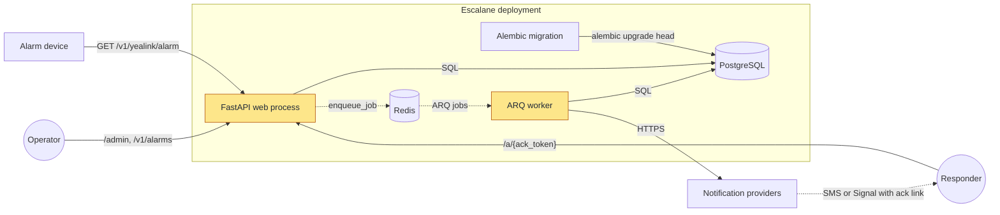
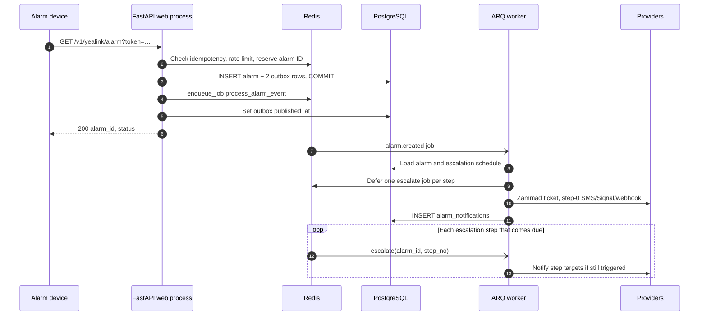
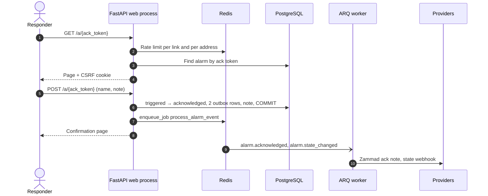
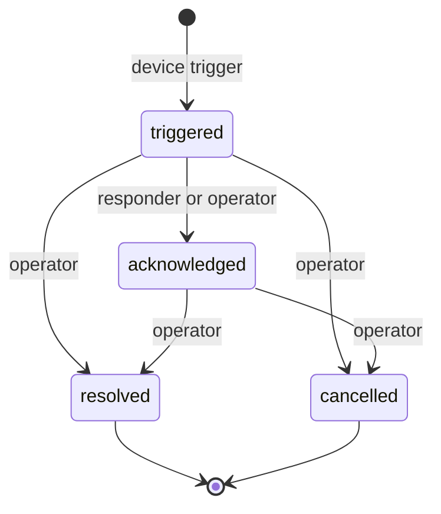
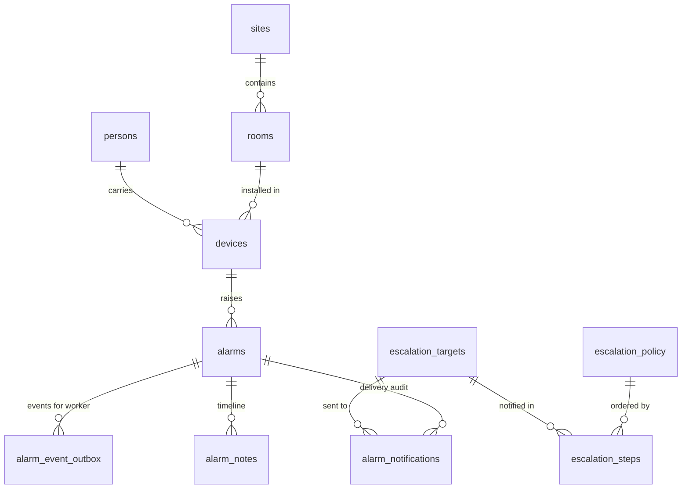

# Architecture

Escalane ships as one Python package but runs in three roles: an Alembic
migration process, a FastAPI web process, and an ARQ worker. All three use the
same installed package and container image. The application also depends on
PostgreSQL, Redis, and whichever notification providers a deployment enables.

This repository is a reference implementation for alarm intake and escalation.
It is neither a general incident-management platform nor a validated
emergency-response system.

## System context

What runs where, and who talks to whom:

Only the API accepts HTTP requests. The worker creates its own database engine,
HTTP client, provider clients, and Redis connection. In the reference Compose
deployment, the migration process updates the schema before either the API or
worker starts. "Notification providers" are Zammad, SendXMS, a Signal REST
bridge, and signed state-change webhooks; each is optional. The static demo in
`pages/` is not part of this picture: it never connects to a running service.

Where in the code:

- [deploy/docker-compose.yml](../deploy/docker-compose.yml): the `migration`,
  `api`, and `worker` services, all from one image
- [src/escalane/web/main.py](../src/escalane/web/main.py): `create_app()` and
  the lifespan that opens the database engine and ARQ Redis pool
- [src/escalane/worker/settings.py](../src/escalane/worker/settings.py):
  `WorkerSettings` (task list, retry limit, cron jobs) and worker `startup()`
- [src/escalane/providers/](../src/escalane/providers/): one client per provider

## Components

| Component | Responsibility |
|---|---|
| `config/` | Loads environment settings (`settings.py`) and defines the application exceptions that web handlers map to HTTP responses (`errors.py`) |
| `telemetry/` | Holds the process-local metrics registry and Prometheus rendering, and instruments database connection pools |
| `persistence/` | Defines the SQLAlchemy schema (including the persisted `AlarmStatus`), engines, and sessions |
| `security/` | Validates device source IPs, outbound URLs, and webhook host allowlists |
| `runtime/` | Provides atomic Redis primitives and rate-limit keys |
| `providers/` | Transports requests to Zammad, SendXMS, Signal, and pinned webhook addresses, plus the simulation mocks |
| `alarms/` | Owns triggers and idempotency, lifecycle transitions, notes, bulk changes, the ordered outbox and its event types, alarm queries and exports, worklist counts, and history |
| `configuration/` | Owns master data, device upserts, escalation policy, seed import, and redacted administrative audit records |
| `notifications/` | Owns escalation targets, payloads, delivery workflows, the shared webhook address resolution, audit records, retry classification, and recovery |
| `operations/` | Provides readiness probes, metrics aggregates, and worker heartbeat snapshots |
| `web/` | Inbound HTTP adapter: application assembly, error mapping, authentication, routes, console helpers, Jinja rendering, translations, and assets |
| `worker/` | Inbound ARQ adapter: task registration, retry translation, escalation scheduling, and recovery jobs |
| `migrations/` | Stores Alembic schema history; current code expects the packaged migration head |
| `pages/` | Contains the source for the separate, disconnected GitHub Pages demo |

Paths in the table are relative to `src/escalane/` unless shown otherwise.

For a first read, follow one alarm: the trigger route
[web/routes/yealink.py](../src/escalane/web/routes/yealink.py), then
[alarms/triggers.py](../src/escalane/alarms/triggers.py) and
[alarms/outbox.py](../src/escalane/alarms/outbox.py), then the worker in
[worker/tasks.py](../src/escalane/worker/tasks.py) and
[notifications/workflows.py](../src/escalane/notifications/workflows.py). The
schema in [persistence/models.py](../src/escalane/persistence/models.py)
explains the rest.

## Dependency rules

`scripts/check_architecture.py` enforces the package boundaries. It rejects
dependencies that are absent from the table below, imports from removed or
unknown namespaces, and dependency cycles.

| Package | May import from |
|---|---|
| `config`, `runtime`, `security`, `telemetry` | No other Escalane package |
| `persistence` | `config`, `telemetry` |
| `providers` | `security` |
| `configuration` | `config`, `persistence` |
| `operations` | `persistence`, `telemetry` |
| `alarms` | `config`, `persistence`, `runtime`, `telemetry` |
| `notifications` | `alarms`, `config`, `persistence`, `providers`, `security`, `telemetry` |
| `web` | `alarms`, `config`, `configuration`, `operations`, `persistence`, `providers`, `runtime`, `security`, `telemetry` |
| `worker` | `alarms`, `config`, `notifications`, `operations`, `persistence`, `providers`, `security`, `telemetry` |

The checker does not restrict imports within the same package. `web` and
`worker` are the two inbound adapters, so feature packages must not import
either one. The checker also enforces three adapter rules:

- Only `web` may import FastAPI or Starlette.
- `web` and `worker` modules may hold an `AsyncSession` (a parameter annotated
  `AsyncSession` or named `session`), but they may not import SQLAlchemy beyond
  `sqlalchemy.ext.asyncio` (the worker also imports `sqlalchemy.exc` to classify
  retryable errors) or call session data methods such as `execute`, `add`, or
  `commit`. Queries and transactions belong to feature functions.
- No module may import another module's underscore-prefixed names.

`notifications` deliberately writes the delivery state it owns on shared rows,
such as restoring `alarms.zammad_ticket_id` and re-arming outbox ACK events
during recovery; this is notification delivery state, not alarm lifecycle.

Keep HTTP parsing, cookies, rendering, and response formatting in `web`. Keep
ARQ task signatures, retries, and scheduling in `worker`, and keep calls to
external systems in `providers`.

## Alarm and delivery flow

### A device triggers an alarm

What happens between a button press and the first page to a responder:

The route (1) checks the source IP and token, then `TriggerService` does the
rest. A repeated trigger from the same device token within 30 seconds returns
the existing alarm instead of creating a second one (2). The alarm and its `alarm.created` and
`alarm.state_changed` outbox rows commit in one transaction (3), so an alarm
never exists without its events. If enqueueing (4) fails, the device gets a 503
but the alarm is already stored, and the worker's recovery job publishes the
pending rows later. Escalation jobs are queued (9) before any provider call, and
each `escalate` job only pages if the alarm is still `triggered`.

Where in the code:

- [web/routes/yealink.py](../src/escalane/web/routes/yealink.py):
  `yealink_alarm()`, source IP and token checks
- [alarms/triggers.py](../src/escalane/alarms/triggers.py):
  `TriggerService.process_trigger()` and `create_alarm()`
- [alarms/outbox.py](../src/escalane/alarms/outbox.py):
  `dispatch_pending_alarm_events()` and the stable ARQ job IDs
- [worker/tasks.py](../src/escalane/worker/tasks.py): `process_alarm_event()`,
  `alarm_created()`, `escalate()`
- [notifications/workflows.py](../src/escalane/notifications/workflows.py):
  `deliver_new_alarm()`, `deliver_escalation_step()`

### A responder acknowledges

The notification text carries an acknowledgement link (`/a/{ack_token}`). This
is what happens when the responder opens it:

The state change in step 6 is a compare-and-set on the current status, so two
responders acknowledging at once produce one acknowledgement. From then on,
pending `escalate` jobs find the alarm no longer `triggered` and send nothing.
Operators resolve or cancel alarms through `/admin` or `/v1/alarms`; those go
through the same `apply_alarm_state_change()` path (or its bulk variant) and emit
`alarm.state_changed`.

Where in the code:

- [web/routes/ack.py](../src/escalane/web/routes/ack.py): `ack_page()`,
  `ack_submit()`
- [alarms/lifecycle.py](../src/escalane/alarms/lifecycle.py):
  `apply_alarm_state_change()`, `acknowledge_alarm()`, `transition_alarm()`
- [worker/tasks.py](../src/escalane/worker/tasks.py): `alarm_acked()`,
  `alarm_state_changed()`

### Alarm states

Which status changes the code allows:

`resolved` and `cancelled` are final. Soft deletion (`deleted_at`) is separate
from status: it hides an alarm, and the worker skips deleted alarms. The table
of allowed moves is `_ALLOWED_TRANSITIONS` in
[alarms/lifecycle.py](../src/escalane/alarms/lifecycle.py); the states are
`AlarmStatus` in [persistence/models.py](../src/escalane/persistence/models.py).

### Delivery guarantees and recovery

When Escalane creates or changes an alarm, it writes the status change and its
outbox rows in the same PostgreSQL transaction. It publishes each alarm's events
in order. Once ARQ accepts an event, Escalane marks the corresponding outbox row
as published. If enqueueing fails, the row stays in PostgreSQL for the worker to
recover at startup or during its once-per-minute
`recover_incomplete_alarm_events` cron job.

The worker reloads the stored state before it acts. Initial notifications and
escalations may be retried, which makes calls to providers at least once rather
than exactly once. Stable job identities, current-state checks, retry
classification, and delivery records reduce duplicate effects, but a provider
can still receive the same request more than once.

## State ownership

| Store | What it stores | What happens during recovery |
|---|---|---|
| PostgreSQL | Master data, escalation policy and targets, alarms, notes, administrative audit, notification audit, and the ordered lifecycle-event outbox | This is the durable source of truth. Back up and restore it consistently. |
| Redis | ARQ jobs, delayed work, browser sessions, CSRF/session data, trigger reservations, idempotency state, rate limits, and simulation notification records (newest 500) with the mock ticket counter | This data coordinates current work. A restart invalidates sessions and requires a tested queue recovery procedure. |

If Redis restarts or ARQ retries a job, PostgreSQL remains the source of truth.
Simulation records exist only for the demonstration flow and cannot establish
that a provider received a delivery. The worker and the API share the
simulation records and the mock ticket counter through Redis, so
`/v1/simulation/notifications` and the console's simulation page show
simulated deliveries in the reference Compose deployment. Only the newest 500
records are kept, and the clear action removes them.

### PostgreSQL tables

How the durable tables relate:

The first three rows are master data that operators maintain through `/admin`
or the seed import. An alarm also copies its person, room, and site IDs at
trigger time, so later master-data edits do not rewrite history. The three
alarm child tables are deleted with their alarm. Two tables stand alone and are
left out of the diagram: `admin_audit_events` (redacted record of admin
changes) and `dashboard_revision` (a counter the worklist polls for changes).

Where in the code:

- [persistence/models.py](../src/escalane/persistence/models.py): all tables
- [migrations/versions/](../migrations/versions/): their Alembic history

## HTTP and trust boundaries

| Endpoint | Access control |
|---|---|
| `/healthz`, `/readyz` | Public liveness and dependency/schema readiness |
| `/v1/yealink/alarm` | Per-device token, Redis-backed limit, and source allowlist outside simulation |
| `/a/{ack_token}` | Bearer capability; responses are marked no-store; 10 requests per minute per link and client address, 120 per minute per address |
| `/v1/alarms`, `/v1/admin`, `/metrics`, `/healthz/details` | Static `X-Admin-Key` comparison |
| `/admin/*` | Admin-key login exchanged for a one-hour Redis session; mutating forms require CSRF |
| `/v1/simulation/*` | Admin key and simulation mode; routes return 404 when simulation is disabled |

Escalane trusts forwarded client and scheme headers only when the immediate peer
matches a configured proxy. It validates non-loopback `BASE_URL` values and
enabled provider URLs against their HTTPS and host-allowlist rules. Browser
assets remain on the same origin, and the application does not configure CORS.

## Configuration and deployment

Runtime settings live in `src/escalane/config/settings.py`. Process environment
variables take precedence over the optional `.env` file at the repository root,
and `.env.example` documents the available settings. On startup, Escalane
validates production credentials, source allowlists, whether simulation is
restricted to loopback, provider endpoints, and webhook controls.

The Dockerfile installs both the package and its migrations into one non-root
image. `deploy/docker-compose.yml` runs that image in the migration, API, and
worker roles alongside PostgreSQL and Redis. The API and worker wait for a
successful migration. This Compose setup is a reference deployment and does
not provide TLS termination, external monitoring, scheduled backups, or managed
secrets.

CI builds a wheel to verify package integrity, while the tested container image
is the supported release artifact. The `pages/` source builds separately into
the ignored `build/pages/` directory and may be published to GitHub Pages. The
static site never connects to a running Escalane service.

### Build and release

How a tagged commit becomes a published image (all steps start manually from
the Release workflow on `main`):

```mermaid
flowchart LR
    tag[Annotated tag on main] --> preflight[preflight]
    preflight -->|tag commit| validate["validate_release.py"]
    validate --> ci["ci.yml checks"]
    ci --> build[Build image once]
    build -->|escalane:release-candidate| smoke["smoke_container.sh"]
    smoke -->|docker push| ghcr[(ghcr.io image)]
    ghcr --> ghrel[GitHub Release]
    classDef focus fill:#fde68a,stroke:#b45309,color:#1f2937
    class smoke focus
```

`preflight` refuses a tag whose commit is not on `origin/main`. `validate`
checks that tag, package version, and changelog agree. `ci` reruns lint, type,
architecture, migration, security, and package checks on that exact commit.
The image that passes the migrate-and-probe smoke test is the one pushed, and
its digest is recorded in the GitHub Release. Pages has its own manual workflow
that runs `build_pages.py` and `validate_pages.py`.

Where in the code:

- [.github/workflows/release.yml](../.github/workflows/release.yml) and
  [.github/workflows/ci.yml](../.github/workflows/ci.yml)
- [.github/workflows/pages.yml](../.github/workflows/pages.yml)
- [scripts/validate_release.py](../scripts/validate_release.py),
  [scripts/smoke_container.sh](../scripts/smoke_container.sh)
- [Makefile](../Makefile): the same checks for local runs (`make check`)
- [RELEASING.md](RELEASING.md): the human steps around this pipeline

## Extending the application

- Put a new query or state change in the feature that owns the data (`alarms/`,
  `configuration/`, or `notifications/`). Feature functions raise
  `config.errors` exceptions or their own exception types, never HTTP
  exceptions.
- Add HTTP routes under `web/routes/` and register them explicitly in
  `ALL_ROUTERS`. Registration order matters where a literal path shares a
  prefix with a parameterized one. Shared console rendering and session helpers live in `web/console.py`.
- Put new provider transports behind the narrow protocols in `providers/`, and
  leave notification policy in `notifications/`.
- Register new worker behavior as ARQ functions without changing existing
  payload formats or job IDs.
- Represent each schema change with a new Alembic revision, update
  `EXPECTED_ALEMBIC_HEAD` in `operations/readiness.py`, and apply the revision
  before starting API or worker code that depends on it.
- Preserve existing HTTP routes, worker payloads, database schema, provider
  behavior, packaged templates and assets, and operator workflows unless a
  change explicitly updates them.

The [Setup](SETUP.md), [Operations](OPERATIONS.md),
[Integrations](INTEGRATIONS.md), and [Frontend](FRONTEND.md) guides cover the
corresponding developer and operator tasks.
